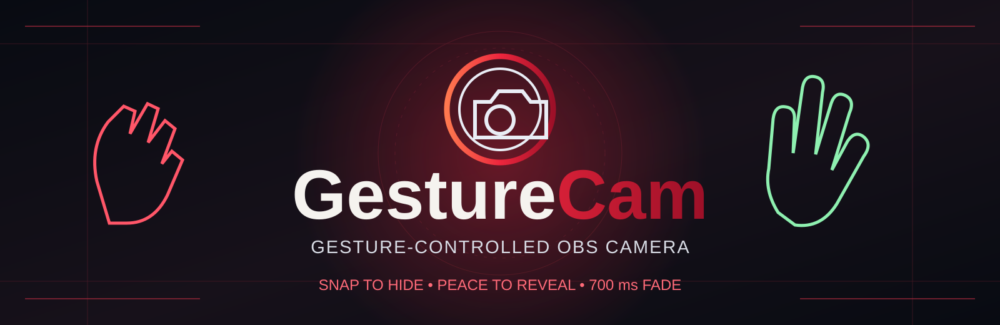

<div align="center">



# GestureCam

**Control your OBS webcam with simple hand gestures.**

Snap to fade out. Show a peace sign to fade in.

[](https://github.com/himanshu08-bot/GestureCam/releases/tag/v1.2.0)
[](https://github.com/himanshu08-bot/GestureCam)
[](LICENSE)

</div>

## What is GestureCam?

GestureCam is a lightweight Windows desktop controller that uses a webcam and MediaPipe hand tracking to control the visibility of a camera source in OBS Studio. It is designed for streamers, online meetings, and hands-free camera control.

## Gesture guide

| Gesture | Action |
|---|---|
| 🤏 **Finger snap motion** | Fade the OBS camera source **out** |
| ✌️ **Peace sign (held)** | Fade the OBS camera source **in** |
| 👋 **Wave** | Show camera |
| ✋ **Open palm (held)** | Hide camera |

**Transition:** 700 ms, linear fade, no sound.

> Snap detection is a visual approximation: it looks for thumb/middle-fingertip contact followed by quick separation. It does not listen for an acoustic snap. Detection may vary with camera angle, lighting, and frame rate.

## Features

- Real-time hand landmark tracking with MediaPipe.
- OBS WebSocket v5 integration.
- Smooth opacity fade using an OBS Color Correction filter.
- Manual Show/Hide controls and live camera preview.
- Configurable gesture actions, hold time, cooldown, and camera backend.
- Local processing: camera frames are not uploaded to a cloud service.

## Requirements

- Windows 10/11 (64-bit).
- Python 3.11 recommended.
- OBS Studio 28 or newer.
- A webcam.
- Internet access on first run to download the MediaPipe hand-landmarker model if it is not already in `assets/`.

## Installation

### 1. Download or clone

Download the ZIP from [Releases](https://github.com/himanshu08-bot/GestureCam/releases), or:

```powershell
git clone https://github.com/himanshu08-bot/GestureCam.git
cd GestureCam
```

### 2. Create a virtual environment

```powershell
py -3.11 -m venv .venv
.\.venv\Scripts\Activate.ps1
python -m pip install --upgrade pip
pip install -r requirements.txt
```

If PowerShell blocks activation in the current window:

```powershell
Set-ExecutionPolicy -Scope Process -ExecutionPolicy Bypass
.\.venv\Scripts\Activate.ps1
```

### 3. Create your local configuration

```powershell
Copy-Item config.example.json config.json
```

Open `config.json` and enter your own OBS details. **Never commit your personal `config.json` or OBS password.**

### 4. Configure OBS Studio

1. Open OBS Studio and select the scene containing your webcam.
2. Add or identify the **Video Capture Device** source to control.
3. Open **Tools → WebSocket Server Settings**.
4. Enable the WebSocket server and use port **4455** (or update `obs_port` if changed).
5. Enable authentication and set a strong password.
6. Keep the server local. Do not expose port 4455 to the public internet.
7. Make sure `scene_name` and `camera_source_name` in `config.json` exactly match OBS.

### 5. Launch

```powershell
python main.py
```

1. Click **Connect to OBS**.
2. Click **Start gesture control**.
3. Hold a peace sign to fade the camera in.
4. Make the snap motion to fade the camera out.

Use **Show camera** and **Hide camera** for manual control.

## Use in Zoom, Meet, or Discord

1. In OBS, click **Start Virtual Camera**.
2. In your meeting app, select **OBS Virtual Camera**.
3. GestureCam controls the webcam source inside the OBS scene.

For a privacy-friendly hidden state, place a solid background source below the webcam source in OBS.

## Configuration

See `config.example.json` for all keys. Important settings:

| Key | Purpose |
|---|---|
| `camera_index` | Webcam index (usually `0`) |
| `obs_host` / `obs_port` | OBS WebSocket address; normally `127.0.0.1:4455` |
| `obs_password` | Your local OBS WebSocket password |
| `scene_name` | Exact OBS scene name |
| `camera_source_name` | Exact webcam source name |
| `wave_action`, `open_palm_action`, `peace_action`, `snap_action` | `show`, `hide`, or `toggle` |
| `gesture_hold_seconds` | Hold time before a pose triggers |
| `cooldown_seconds` | Delay before another gesture can trigger |
| `transition_duration_ms` | Fade duration; default 700 |
| `transition_easing` | Fade easing; default `linear` |
| `transition_filter_name` | OBS Color Correction filter name |
| `camera_backend` | `MSMF`, `DSHOW`, or `ANY` |

Restart GestureCam after changing settings.

## Troubleshooting

**OBS connection refused**
- Confirm OBS is running and WebSocket is enabled.
- Confirm the port and password match `config.json`.
- Use `127.0.0.1` when OBS and GestureCam run on the same PC.

**Webcam does not open**
- Close other apps using the webcam.
- Try `camera_index` values `1` or `2`.
- Try `DSHOW` or `ANY` for `camera_backend`.

**Camera source not found**
- Check exact spelling, spaces, and capitalization of the scene and source names.
- For this MVP, keep the webcam source directly in the configured scene, not nested in a group.

**Gestures are unreliable**
- Keep the full hand in frame, use even lighting, and avoid a busy background.
- Increase `gesture_hold_seconds` if needed.
- The detector assumes a mostly upright hand; rotated hands may be less reliable.

## Privacy and security

- Hand tracking runs locally; camera frames are not uploaded by GestureCam.
- Keep your OBS WebSocket password only in your local `config.json`.
- Never publish `config.json`, passwords, tokens, or private recordings.
- Do not expose OBS WebSocket port 4455 to the internet.

## Current limitations

- Windows desktop MVP; not a signed installer or native OBS plugin.
- Controls one configured webcam source in one scene.
- Snap detection is visual and approximate, not microphone-based.
- Hiding the OBS source does not physically disable the webcam.
- Reliability depends on lighting, camera angle, and frame rate.

## License

Released under the [MIT License](LICENSE).

<div align="center">

**Built by Himanshu** · *Hands-free camera control, one gesture at a time.*

</div>
